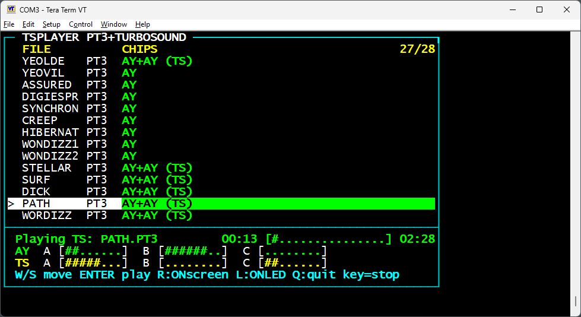

# TSPLAYER



TSPLAYER is a CP/M PT3 music player for RomWBW and compatible Z80 systems. It includes TurboSound playback for the dual AY board in [r0b0t1cu/RC2014-Turbo-Sound](https://github.com/r0b0t1cu/RC2014-Turbo-Sound), while retaining playback for single-AY PT3 files.

The player lists `.PT3` files on the current drive, shows playback status and on-screen channel meters, and can drive the eight LEDs on the RCBus Digital I/O module.

## Features

- Plays PT3 files on a single AY-compatible chip or as a two-module TurboSound file.
- Uses HBIOS to discover the shared AY port pair; the TurboSound board's `$F8` and `$F9` soft-select commands choose AY1 or AY2. HBIOS does not need to report a second AY device.
- Shows per-channel meters for both AY chips on screen.
- Drives four LEDs per AY chip on Digital I/O port 0. Each four-LED bar grows outward from the center; the level combines that chip's three channel volumes.
- Allows live screen refresh (`R`) and LED output (`L`) to be toggled independently from the file menu.

## Requirements

- A Z80 system running CP/M with RomWBW HBIOS services.
- An HBIOS-supported AY I/O device.
- For TurboSound playback, a compatible dual-AY TurboSound board using the `$F8` / `$F9` chip-select convention.
- For the hardware LED meter, an RCBus Digital I/O module at port 0.
- TASM 3.x / TASM32 to assemble the source. The prebuilt `TSPLAYER.COM` is included for convenience.

The board itself can be used on RC bus systems and, with an appropriate adapter, on ZX Spectrum systems. TSPLAYER specifically requires a CP/M and HBIOS environment; it is not a ZX Spectrum-native loader.

## Build

With TASM available on `PATH`, run:

```text
tasm -t80 -g3 -fFF -dWBW TSPLAYER.ASM TSPLAYER.COM TSPLAYER.LST
```

The source includes two copies of the PT2/PT3 playback engine derived from RomWBW's `TUNE` application. Copy `TSPLAYER.COM` and PT3 files to a CP/M drive using a transfer method supported by the target system, then run `TSPLAYER`.

See [Building](docs/BUILDING.md) for assembler details and [Using TSPLAYER](docs/USAGE.md) for controls and file format notes.

## Controls

| Key | Action |
| --- | --- |
| `W` / `S` | Move through the file list |
| `Enter` | Play the selected PT3 file |
| `R` | Toggle live on-screen meter and elapsed-time refresh |
| `L` | Toggle the hardware LED meter; turning it off clears the LEDs |
| Any key during playback | Stop playback and return to the list |
| `Q` | Quit |

Both refresh options start enabled. Turning screen refresh off leaves playback and LED updates running.

## TurboSound file layout

TurboSound files contain two PT3 modules followed by a TurboSound footer recognized by the player. The first module plays on AY1 and the second on AY2. Ordinary PT3 files play on one AY. TSPLAYER does not provide VGM playback.

## Related project

- [RC2014 Turbo Sound board](https://github.com/r0b0t1cu/RC2014-Turbo-Sound) — hardware design, schematic, board renders, and fabrication files.

## Credits

- **S.V. Bulba** — author of the original Pro Tracker 2/3 player engine.
- **Wayne Warthen and the RomWBW contributors** — RomWBW, HBIOS, and the `TUNE` application from which the PT2/PT3 engine is derived.

## License

TSPLAYER is released under the **GNU General Public License v3.0**; see [LICENSE](LICENSE). The included PT2/PT3 playback engine is derived from RomWBW's `TUNE` application and is GPLv3. The source retains its upstream notices.

Copyright (C) 2026 r0b0t1cu.
